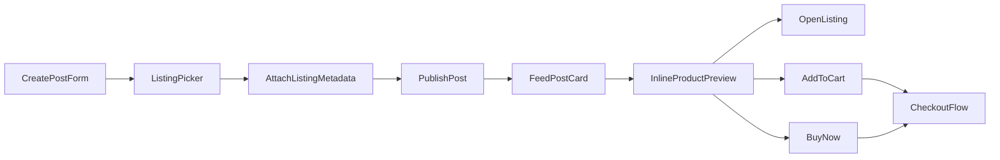

# Shoppable Posts Epic Spec

## Objective
Let community posts carry attached marketplace listings so users can discover products in context, open the product detail quickly, and complete add-to-cart or buy-now flows without losing the social context that drove interest.

## Why This Epic First
- It is the fastest path from existing community engagement to incremental commerce conversion.
- The app already has feed composer, feed cards, listing routes, and add-to-cart/buy-now UI patterns.
- It creates reusable primitives for creator storefronts, product mentions, seller chat, and social proof modules.

## User Stories

### Creator / Seller
- As a creator, I can attach one or more listings to a post so my audience can shop directly from the content.
- As a seller, I can feature a listing in a launch/update post without manually pasting raw links.
- As a poster, I can remove or reorder attached listings before publishing.

### Buyer / Viewer
- As a feed reader, I can see a compact product preview inline with the post.
- As a shopper, I can open the listing detail from the post without guessing what product is being referenced.
- As a shopper, I can add the product to cart or go straight to buy now from the feed preview.
- As a shopper, I can understand why this product is attached to the post and who shared it.

### Admin / Analytics
- As the team, we can measure how many posts include listings and how those posts convert to listing visits, add to cart, and purchases.

## Scope

### In Scope
- Listing picker inside the post composer.
- Persisting attached listing references in post data.
- Rendering inline product attachment cards inside feed posts.
- Feed-level `Add to cart` and `Buy now` actions for attached listings.
- Analytics for impression, click, add-to-cart, and checkout intent from post attachments.

### Out Of Scope
- Multi-shop carts policy changes.
- Sponsored boosting for shoppable posts.
- Creator commission / affiliate payout logic.
- Full creator storefront and shop-follow graph.
- Chat from a shoppable post.

## UX Flow

## Functional Requirements

### 1. Composer Attachment Flow
- Add an action in `CreatePostForm` to attach products.
- Search should return only eligible active listings.
- The picker should show thumbnail, title, price, and shop name.
- Start with a max of 3 attached listings per post.
- Composer should allow removing an attached listing before submit.

### 2. Post Data Model
- Store attached listings as structured metadata, not freeform URLs.
- Each attachment should include listing id, slug, title snapshot, image snapshot, price snapshot, currency snapshot, and shop snapshot.
- Preserve snapshots so older posts still render usefully if listing titles/images change later.
- On render, prefer live listing data when available, but fall back to the saved snapshot.

### 3. Feed Rendering
- Attached listings should render below the post body/media and above comments/actions.
- The UI should reuse the compact product-card language already used in the community sidebar where possible.
- If a listing is no longer available, render a disabled/unavailable state instead of a broken CTA.
- For posts with multiple listings, start with a vertical stack rather than a carousel to keep implementation simple.

### 4. Commerce Actions
- `Add to cart` should follow the same behavior as current community product suggestion cards.
- `Buy now` should add the item and route to checkout or sign-in if needed.
- If variant/option selection is required, route to listing detail with an explanatory toast.

### 5. Analytics
- Track:
  - post_listing_impression
  - post_listing_open
  - post_listing_add_to_cart
  - post_listing_buy_now
  - post_listing_checkout_started
- Include post id, listing id, author id, feed surface, and rank position where available.

## Technical Design

### Frontend
Likely touchpoints:
- `community/components/CreatePostForm.tsx`
- `community/components/FeedPostCard.tsx`
- `community/components/CommunityProductSuggestionRow.tsx`
- `community/lib/post-media.ts`
- `community/lib/community.ts`
- `lib/routes.ts`

Proposed frontend approach:
- Extract a reusable compact product preview component from `CommunityProductSuggestionRow` or build a sibling component that accepts generic listing attachment data.
- Add composer-local state for attached listings and serialize it into the post payload.
- Add a feed card section that reads attached product metadata and renders CTAs with current add-to-cart behavior.

### Backend / Data
Likely touchpoints:
- post insert/update path in the community data layer
- Supabase schema for post metadata payload or attachment relation
- analytics/event ingestion path already used by app usage tracking

Proposed backend approach:
- Use structured JSON metadata for the first iteration if post payloads already support extensible metadata.
- If current post schema is too rigid, add a dedicated relation table for post listing attachments.
- Resolve live listing data lazily on read, but do not block rendering if it is unavailable.

## Data Model Recommendation

### Option A: JSON Metadata
Pros:
- Fastest to ship.
- Minimal schema expansion if post payload already stores structured metadata.

Cons:
- Harder to query for analytics and admin moderation later.

### Option B: Relational Attachment Table
Pros:
- Easier to query, moderate, and evolve.
- Cleaner enforcement around attachment counts and listing existence.

Cons:
- Slightly more backend work now.

Recommendation:
- If post schema already supports typed metadata cleanly, ship Q1 with JSON metadata plus validation.
- If not, prefer a relation table instead of forcing brittle ad hoc JSON.

## Edge Cases
- Listing deleted after post publish.
- Listing unpublished or out of stock after post publish.
- Seller attaches a listing from a shop they do not own, if that should be restricted.
- Cart rejects add-to-cart because options are required.
- Multiple attached listings from different shops.
- Web and native layout differences for product attachments inside feed cards.

## Rollout Plan
1. Internal dogfood for staff/vendor accounts only.
2. Enable for a small creator/seller cohort.
3. Monitor attach rate, click-through, cart conversion, and error rates.
4. Roll out broadly once conversion is positive and feed quality remains healthy.

## Success Metrics
- Shoppable post creation rate.
- Listing CTR from shoppable posts.
- Add-to-cart rate from shoppable posts.
- Checkout start rate from shoppable posts.
- Purchase conversion rate relative to regular listing traffic.
- No material drop in feed engagement due to over-commercialization.

## Dependencies
- Stable listing search/picker source.
- Reusable cart action hooks for feed contexts.
- Analytics event taxonomy alignment.
- Moderation guidance for commercial posts in community surfaces.

## Open Product Decisions
- Should any user be able to tag products, or only shop owners / approved sellers?
- Do we allow multiple products from different shops in one post?
- Should product attachments be rendered in reposts/shares exactly as in originals?
- Should comments/replies support product attachments later, or only top-level posts?

## Recommended Next Slice After MVP
- Shop follow from shoppable posts.
- Social proof on attached listings.
- Seller chat from the product preview.
- Creator storefront page that aggregates attached products across posts.
